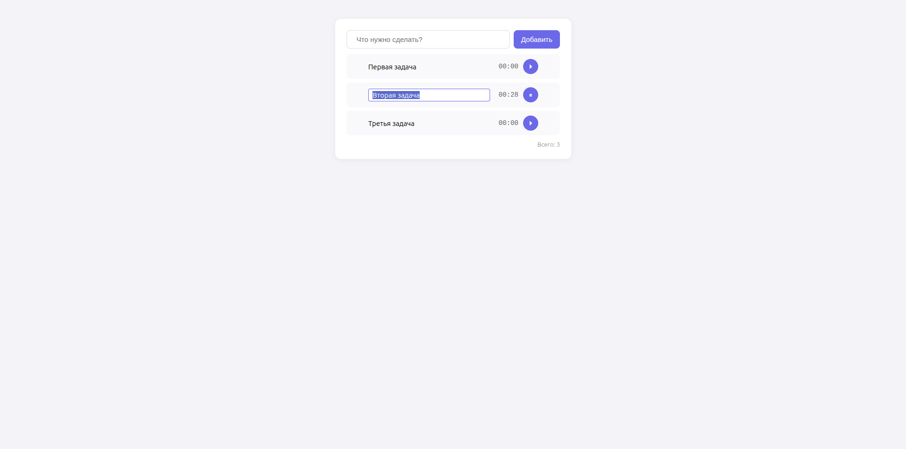
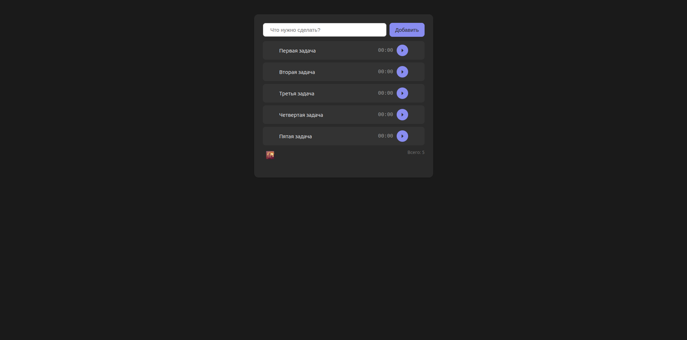

# Todo App




Полноценное full-stack приложение для управления задачами с таймером.

## Возможности

- ✅ Добавление, удаление, редактирование задач
- ✅ Таймер для каждой задачи (Пуск/Пауза)
- ✅ Только одна задача может идти одновременно
- ✅ Сохранение прогресса таймера при паузе
- ✅ Поиск по задачам в реальном времени
- ✅ Тёмная тема с сохранением выбора
- ✅ Счётчик задач, пустое состояние
- ✅ Данные хранятся на сервере в БД (не в localStorage)

## Технологии

**Frontend:**
- HTML5, CSS3 (Flexbox, CSS-переменные, тёмная тема)
- JavaScript (ES6+, fetch, работа с DOM)

**Backend:**
- Python 3.12
- FastAPI
- SQLAlchemy + SQLite
- Pydantic (валидация)
- Uvicorn (ASGI-сервер)

**Деплой:**
- Frontend: GitHub Pages
- Backend: Render

## API

- `GET /tasks` — список задач
- `POST /tasks` — создать задачу
- `PATCH /tasks/{id}` — обновить задачу
- `DELETE /tasks/{id}` — удалить задачу
- `POST /tasks/{id}/toggle` — запустить/остановить таймер

Документация: [Swagger UI](https://todo-api-xxxx.onrender.com/docs)

## Как запустить локально

### Backend
```bash
cd backend
python3 -m venv venv
source venv/bin/activate
pip install -r requirements.txt
uvicorn api:app --reload